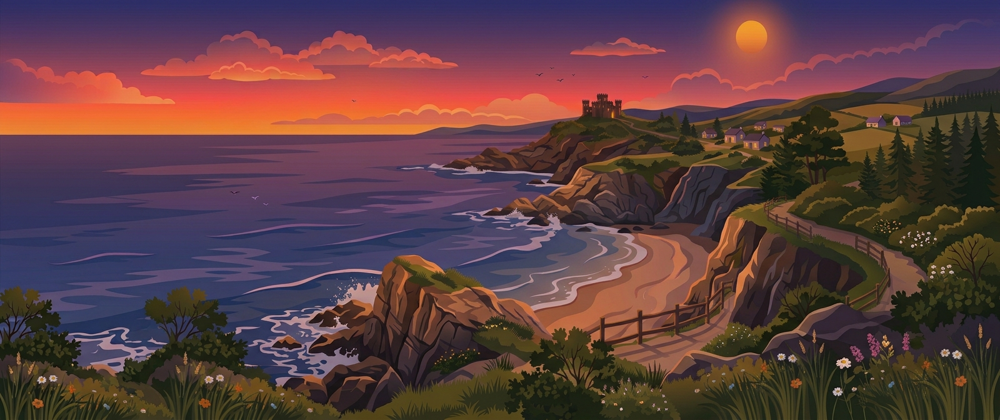
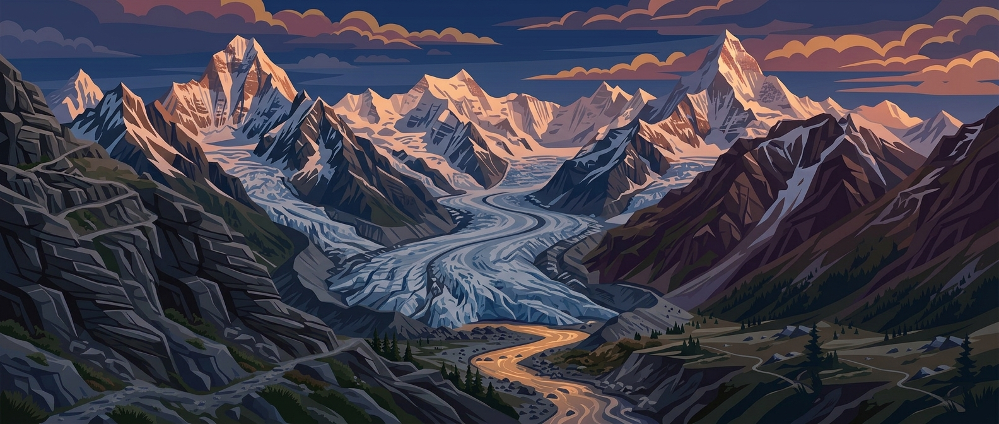
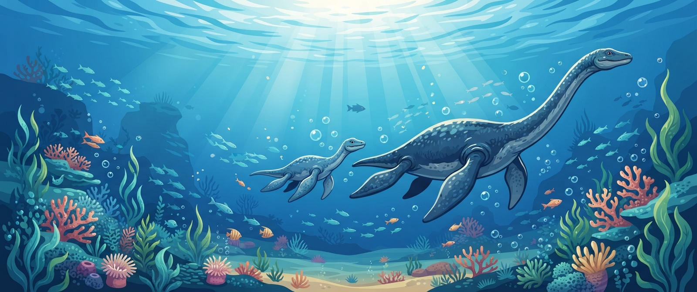

# Desktop Vector Wallpapers 

<h3 align="left">
Welcome to my wallpapers repository
</h3>

This is a collection of vector-art style wallpapers I made using prompts in Gemini, there are around 40. I might add to this collection over time.

Themes include cows, ducks, dinosaurs, ice-age animals, castles, beaches, mountains, and many have scene variations of day/morning, and evening/night lighting.

All wallpapers here have 21:9 aspect ratios, and are 1600 x 672px in size (Gemini won't generate larger sizes for this aspect). I'm using them on a 3440 x 1440 monitor.

21:9 aspect is suitable for resolutions:

• 1280 × 540 – Ultrawide SD (rare/basic)
• 2560 × 1080 - (WFHD)
• 3440 × 1440 - (UWQHD)
• 3840 × 1600 - (UWQHD+ / QHD+ )
• 5120 × 2160 - (5K2K Ultrawide)

# Example Screenshots

  

  

  

  

# Usage

Download and copy to your desktop backgrounds folder. Use your chosen desktop environment to set them as wallpaper.