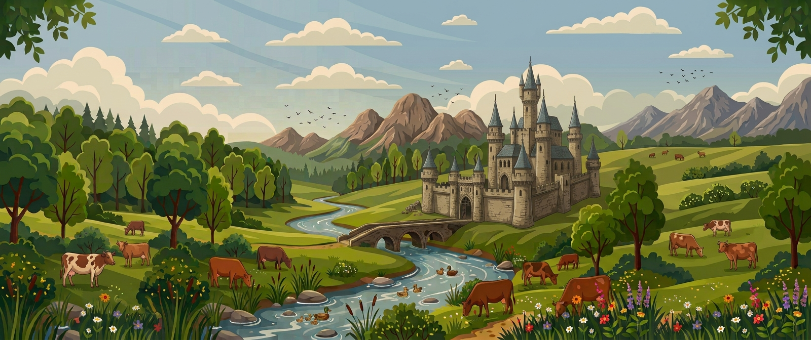

# Desktop Vector Wallpapers 

<h3 align="left">
Welcome to my wallpapers repository
</h3>

This is a collection of over 40 vector-art style wallpapers I made using prompts in <a href="https://gemini.google.com/app">Gemini</a>, which were then upscaled using <a href="https://flathub.org/en/apps/org.upscayl.Upscayl">Upscayl</a>.

Themes include beaches, castles, cows, dinosaurs, ducks, ice-age animals, mountains. Some have scene variations of day/morning, and evening/night lighting.

All wallpapers have 21:9 aspect ratios, and are 3440 x 1440px in size.

21:9 aspect is suitable for resolutions:

• 1280 × 540 – Ultrawide SD (rare/basic)

• 2560 × 1080 - (WFHD)

• 3440 × 1440 - (UWQHD)

• 3840 × 1600 - (UWQHD+ / QHD+ )

• 5120 × 2160 - (5K2K Ultrawide)

## Example Screenshots

  

## Usage

Download and copy to your desktop backgrounds folder. Use your chosen desktop environment to set them as wallpaper.